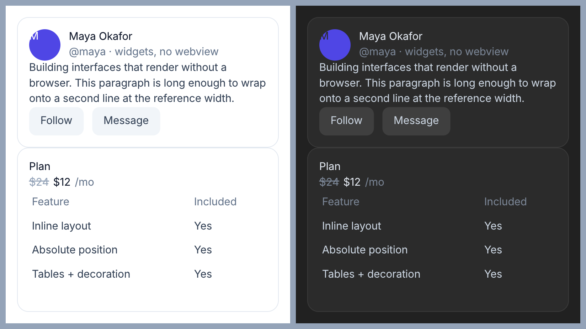
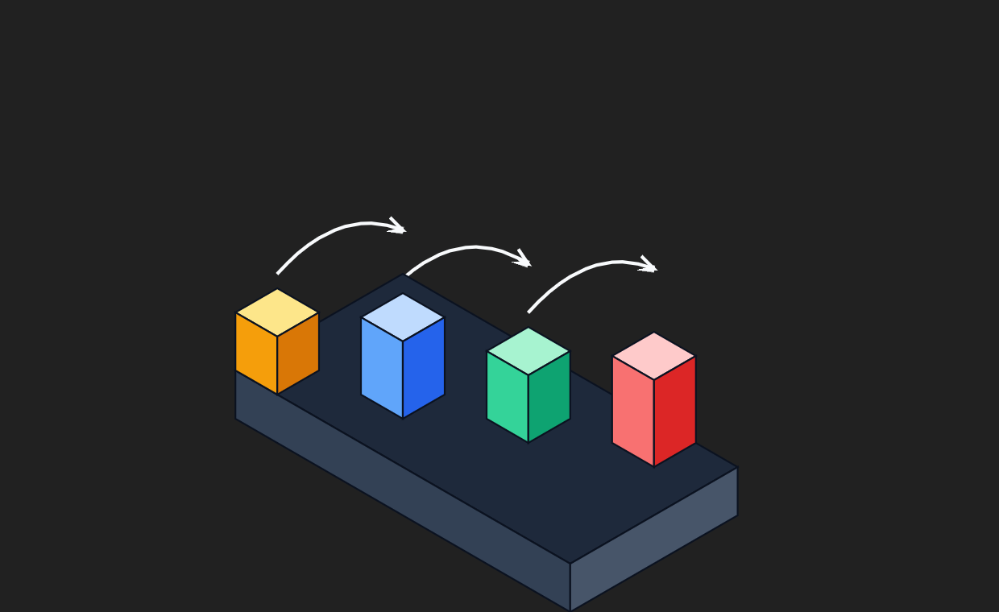

# libcui-widget

A standalone C library that renders a **widget document** into pixels, painting
through CUI's software rasterizer. It is the "extra handle" on top of CUI: CUI
supplies the drawing primitives (rects, borders, text, the rasterizer); libcui-widget
supplies the widget layer above it — a DOM tree, CSS cascade and layout,
hit-testing and pointer events.

It speaks the **same RenderOps document contract** the Telegram widget host
speaks. An application that already drives CUI can embed this library and render
widgets itself, with **no ceiling but the host's own resources**.



An everyday use case — a social post with a **post action bar** (like / comment /
share / save) where every icon is drawn as inline SVG, no icon font, no image
assets:



And a pipeline **diorama**: because the engine is a 2D rasterizer, the 3D look is
computed as isometric polygons — four stages (source → build → test → deploy)
with dashed flow arrows, every shape a 2D vector. Regenerate with
`python3 tools/diorama.py > docs/diorama.json && ./build/cuiw-render docs/diorama.json docs/diorama.png 620 2 dark`.

The same diorama, **animated**: a stream of glowing packets flows along each arc,
driven by a CSS `@keyframes` opacity animation with a staggered `animation-delay`
per packet (so the bright point sweeps source → deploy). Export it as a GIF or
mp4 — CUI itself only writes PNG (`cui_write_png`), so `tools/flow-gif.sh` renders
a deterministic frame sequence with `cuiw-render` and encodes it with ffmpeg
(two-pass palette for an accurate GIF, plus H.264 mp4):


Regenerate the still with
`python3 tools/flow.py > docs/flow.json && ./build/cuiw-render docs/flow.json docs/flow.png 620 2 dark 420`,
or the animation with `./tools/flow-gif.sh` (→ `docs/flow.gif` + `docs/flow.mp4`).
`cuiw-render` can also emit any animation as a numbered PNG sequence for external
encoding: `./build/cuiw-render docs/flow.json 'frames/%04d.png' 620 2 dark 0 48 20`.

Your application owns the RenderOps document and calls `cuiw_send` / `cuiw_touch` /
`cuiw_paint`; libcui-widget turns that into a DOM + CSS cascade + layout + widget
paint, and draws through libcui's rasterizer.

## Isolation

libcui-widget **links only libcui and the C/C++ runtime** — no QuickJS, no spec
validator, no CPU/memory caps, no network, no WebView. The trusted host drives
everything and owns the document. `examples/render_png.c` proves it: a full
widget → PNG over the C ABI alone, and `nm` over the binary shows **zero**
sandbox symbols (`quickjs`, `JS_*`, `validator`, `tw_*`, …). Run it:
`./build/cuiw-render "" cuiw-render.png`.

Trade-off, stated plainly: because there is no sandbox, **the host is trusted**.
This library assumes the RenderOps come from a source you already trust.

## Build

Requires CMake ≥ 3.20, a C++20 compiler, and a **built** CUI checkout
(`build/libcui.a`). macOS frameworks are linked for you.

```sh
# CUI_ROOT defaults to ../CUI/vendor/CUI; override with -DCUI_ROOT=/path/to/CUI
cmake -S . -B build -G Ninja -DCMAKE_BUILD_TYPE=Release
cmake --build build
```

| artifact | what it is |
| --- | --- |
| `build/libcui-widget.a` | the static library |
| `build/cuiw-render` | isolation-proof PNG example |
| `build/cuiw-probe` | pixel probe (edge scan) |

## Drop-in (amalgamation)

Like CUI ("two files"), this library drops in: `python3 tools/amalgamate.py`
emits `cuiw.h` + `cuiw.cpp`. Put **four** files in one directory (`cui.h cui.c`
are CUI's) and compile:

```sh
clang -std=c99 -O2 -I. -DCUI_NO_APP -c cui.c -o cui.o        # CUI once, as C
clang++ -std=c++20 -O2 -I. -DCUI_DROPIN -c cuiw.cpp -o cuiw.o
clang++ -std=c++20 -O2 -I. -DCUI_DROPIN my_app.cpp cuiw.o cui.o -o my_app
```

`-DCUI_NO_APP` drops CUI's window layer (correct headless, and on macOS compile
`cui.c` as C — Cocoa headers break under ObjC). Renders a PNG **byte-identical**
to the CMake build. Honest line: *"four files, two of them CUI's, needs C++20"* —
**not** "no dependencies."

## Using it (C ABI — `include/cuiw.h`)

```c
#include "cuiw.h"

cuiw_renderer_t r = cuiw_create("dark", 400.0, 2.0);   // theme, width_css, dpr
cuiw_send(r, "{\"type\":\"ops\",\"ops\":[...]}");       // build the document
cuiw_frame f = cuiw_paint(r);                          // rasterize now
// f.rgba is premultiplied RGBA8, f.width×f.height physical px
cuiw_frame_free(&f);
cuiw_click(r, 120.0, 300.0);                           // pointer in CSS px
cuiw_destroy(r);
```

- **Ownership** — `cuiw_paint` hands you a frame you own → `cuiw_frame_free`.
  Strings in are borrowed; strings out are valid until the next call.
- **Threads** — calls on a handle are serialized by an internal mutex. The
  optional frame clock runs on its own thread; copy what you need in the callback.
- **Capabilities are queryable** — call `cuiw_has_feature` rather than assuming.
  Unsupported features **degrade gracefully**, never silently mis-render. Full
  table: [`docs/CAPABILITIES.md`](docs/CAPABILITIES.md).

## Pixel-regression gate

`examples/app/widget_app.c` renders a representative widget headless to a light
and a dark PNG. `tools/pxdiff.c` compares the fresh render against committed
goldens **pixel by pixel** and exits non-zero on any difference, so a layout or
paint regression fails the build instead of shipping.

```sh
cmake --build build --target widget-app pxdiff
./build/widget-app actual        # → actual/widget-{light,dark}.png
./build/pxdiff tests/golden/widget-light.png actual/widget-light.png
# pixels 473040   differing 0 (0.0000%)   max channel delta 0   tol 0   PASS
```

The render is **deterministic** — CUI's vendored `stb_truetype` plus
byte-identical bundled fonts plus a static document — so **one set of goldens
gates every platform**. `.github/workflows/ci.yml` runs the gate on
`ubuntu-24.04` (gcc + clang), `macos-latest` and `windows-2022` (MSVC) on every
push. A deliberate change is a **deliberate golden update**: regenerate with
`./build/widget-app tests/golden` and commit the images with the code change.

## Capabilities

A **block + flexbox subset** of CSS — **25 of 27** tracked features: block & flex
layout (incl. flex-wrap), id/class/tag selectors, border-radius, text-align,
font-weight, min-height, `vertical-align` (super/sub/middle/length), CSS variables
(`var()`, custom properties, `:root`), opacity compositing, structural
pseudo-classes (`:first-child`, `:last-child`, `:nth-child(an+b)`/`odd`/`even` plus
`:disabled`), media queries (`@media` `min-width`/`max-width` against the
document width), floats (`float: left`/`right`, inline + block wrap around),
percent width & height, inline layout, CSS tables (auto column widths,
`colspan`), `overflow: hidden` clipping, `text-decoration`, `position: absolute`,
grid (`display: grid`, `grid-template-columns`/`rows`, `gap`; auto-placement),
transitions (`transition` shorthand + longhands, `linear`/`ease`/`ease-in`/
`ease-out`/`ease-in-out`; animates opacity, colors, and px lengths), inline
SVG (an `<svg>` subtree — `rect`/`circle`/`ellipse`/`line`/`polyline`/`polygon`/
`path`, `fill`/`stroke`, `viewBox` — painted through the rasterizer), CSS
`@keyframes` animations (the `animation` shorthand, iteration counts, `infinite`,
stops interpolated per segment), and `<canvas>` 2D-context commands (`fillStyle`/
`strokeStyle`/`lineWidth`, `fillRect`/`strokeRect`/`clearRect`, path ops +
`fill`/`stroke`, `fillText`).

Full table: [`docs/CAPABILITIES.md`](docs/CAPABILITIES.md).

> **Honest limitation.** This is a subset engine, not a browser layout engine.
> Documents leaning on unsupported features lay out differently than in the
> sandboxed host. Query the matrix and design within it.

## Layout

| path | role |
| --- | --- |
| `include/cuiw.h` | the public C ABI — the only header an app includes |
| `include/twidget/*.h` | internal seam headers (stdlib-only) |
| `src/cuiw.cpp` | the C ABI implementation over the renderer |
| `src/cui_renderer.cpp` | document → CSS → layout → paint, through libcui |
| `examples/render_png.c` | isolation proof: full widget → PNG, C ABI only |
| `examples/app/widget_app.c` | the reference app: exercises every supported feature |
| `tools/pxdiff.c` | pixel-by-pixel regression gate |
| `tools/amalgamate.py` | emits the drop-in `cuiw.h` + `cuiw.cpp` pair |
| `tests/golden/*.png` | committed goldens the CI gate compares against |

## Status

Version `0.1.0`, built against CUI `1.4.0` (`cuiw_cui_version()` reads CUI's own
version string, so it can never drift). Builds clean on Linux (gcc, clang),
macOS and Windows (MSVC); the pixel gate passes byte-exact against golden and
correctly fails on a change.