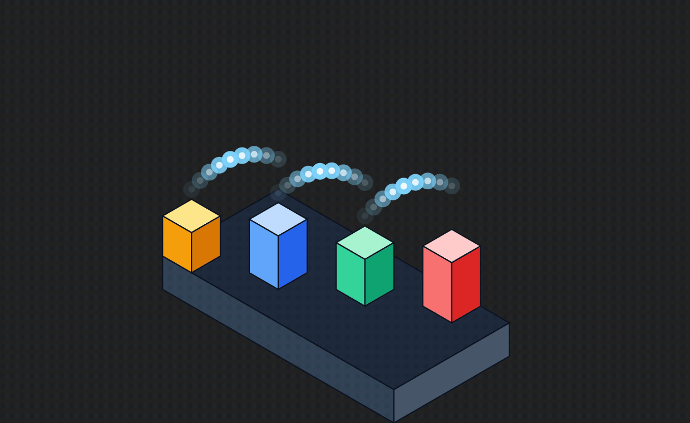
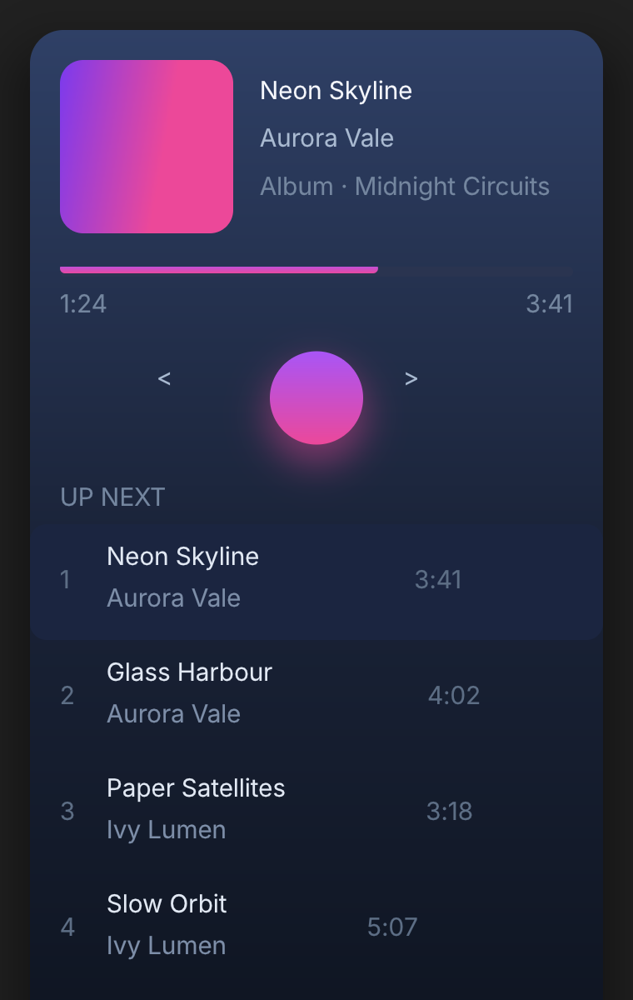
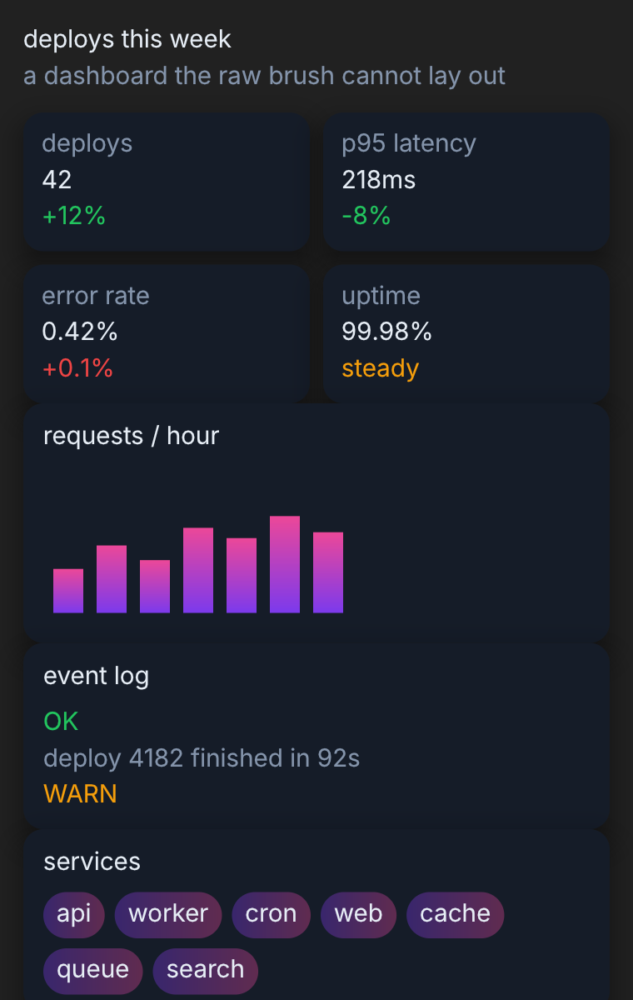

# libcui-widget

This is a toolbox that turns a **description of a screen** into a picture you can
actually see. You tell it what should be on the screen (a button here, a title
there, some colors), and it draws it for you, pixel by pixel.

It is the "extra handle" on top of CUI. Think of it like a kitchen: CUI gives you
the basic tools (a brush, a knife, a pan — the things that draw lines, boxes, and
text). libcui-widget is the recipe book on top: it reads your instructions,
decides where everything goes, and tells the tools what to paint.

It speaks the **same instructions** the Telegram widget host speaks. So if you
already have an app that uses CUI, you can drop this in and draw widgets yourself.

## Why bother — CUI already draws

CUI is a set of drawing tools: draw a box here, write text there, in pixels you
counted by hand. That is enough for a few fixed shapes. It gets painful the moment
a screen has to **respond** — wrap when narrow, grow when the text is longer, move
when someone taps.

This library is the **brain** on top of those tools. You say what a screen *means*
("these three buttons sit in a row, wrap if the screen is narrow, the cancel one is
styled by `.btn`") and it works out every box, every pixel, every frame. With raw
CUI you would count all of that yourself — and count it again each time the screen
changes size.

What the brain does that the brush cannot:

- **Lays things out.** Rows, columns, grids, tables, floats, pin-to-corner,
  percentage sizes, wrap-when-narrow. You describe the relationship; it does the
  arithmetic — and redoes it when the screen resizes.
- **Styles by meaning.** A rule like `.title { color: … }` styles every title at
  once, on every screen. Change the rule once, not forty places.
- **Animates.** Fade a card in, slide a bar, pulse a dot — on a clock you control,
  the same every run.
- **Knows what you tapped.** Because it keeps the shape of the screen, it can tell
  you which piece a finger landed on. A pile of draw calls cannot.
- **Draws the same every time.** One saved "good" picture gates every computer, so
  a change that shifts a single pixel fails the test.

The honest version: the brain is not magic and not a browser. It draws through
CUI's own brush, so it can only do what that brush allows, and a design that leans
on something it lacks will look different than in a web browser. What it buys you
is never hand-counting layout again — and a screen you can actually test.

## What it looks like


Here is a little **3D scene** built with it. The screen is flat, but we tilt the
shapes so they *look* 3D — like a board game seen from above. There are four
steps: source → build → test → deploy. And it **moves**: little glowing dots
travel from one step to the next, like food going down an assembly line.



You can save that moving scene as a GIF or a video to share. The drawing library
itself only saves still pictures (PNG), so a small script (`tools/flow-gif.sh`)
takes a bunch of still frames and stitches them into a GIF and a video for you.

Here is a **real app screen** — a music player. This one screen uses a lot of
the toolbox at once: a card with a **gradient** background and a soft **shadow**,
an **album cover** (a picture drawn from data embedded right in the widget), a
**progress bar** with a gradient fill, play / skip buttons, and a **playlist
that scrolls** when there are more songs than fit. It is the kind of screen a
real music app would show:



Build it with `python3 tools/showcase_app.py > docs/showcase_app.json &&
./build/cuiw-render docs/showcase_app.json docs/showcase_app.png 380 2 dark`.

And here is a **developer dashboard** — the clearest picture of what the brain
adds. Look at what is doing the work:



- The **2×2 stat grid** is `display:grid` — the boxes place themselves. The brush
  has no idea what a grid is; you would count every x/y by hand.
- The **bar chart** is a `<canvas>`: each bar is `translate` + `scale` + a gradient
  fill. Change a number and the bar redraws itself.
- The **event log** scrolls (`overflow:scroll`) — content taller than its box.
- The **service tags** wrap on their own (`display:flex;flex-wrap:wrap`) — add a
  tag and the row re-flows. Nothing was positioned by hand.
- Every card drops a soft **shadow** and reads its colours from one `:root`
  block of **CSS variables**.

Build it with `python3 tools/showcase_dashboard.py > docs/showcase_dashboard.json &&
./build/cuiw-render docs/showcase_dashboard.json docs/showcase_dashboard.png 380 2 dark`.

## No hidden roommates

This toolbox **only needs CUI and the normal C/C++ tools**. There is no hidden
helper doing secret work: no JavaScript engine, no network, no web browser tucked
inside, no limits on how big or small your screen can be. You are in charge.

There is a file, `examples/render_png.c`, that proves it: it draws a whole widget
using nothing but the plain C functions. You can check the finished program and
see it has no hidden helpers inside. Run it:
`./build/cuiw-render "" cuiw-render.png`.

One honest trade-off: because there is no safety net, **you are trusted**. This
library assumes the instructions you feed it come from somewhere you already
trust.

## Build

You need three things: CMake (3.20 or newer), a C++20 compiler, and a **built**
copy of CUI (look for `build/libcui.a`). On a Mac, the extra Apple bits are
hooked up for you.

```sh
# CUI_ROOT defaults to ../CUI/vendor/CUI; override with -DCUI_ROOT=/path/to/CUI
cmake -S . -B build -G Ninja -DCMAKE_BUILD_TYPE=Release
cmake --build build
```

| what you get | what it is |
| --- | --- |
| `build/libcui-widget.a` | the toolbox, ready to use |
| `build/cuiw-render` | a small program that draws a widget to a picture |
| `build/cuiw-probe` | a helper that checks pixels along an edge |

## Carry it with you (just a few files)

Like CUI, you can carry this around as a handful of files instead of a big
project. Run `python3 tools/amalgamate.py` and it hands you two files:
`cuiw.h` and `cuiw.cpp`. Put **four** files in one folder (two of them, `cui.h`
and `cui.c`, belong to CUI) and build:

```sh
clang -std=c99 -O2 -I. -DCUI_NO_APP -c cui.c -o cui.o        # CUI once, as C
clang++ -std=c++20 -O2 -I. -DCUI_DROPIN -c cuiw.cpp -o cuiw.o
clang++ -std=c++20 -O2 -I. -DCUI_DROPIN my_app.cpp cuiw.o cui.o -o my_app
```

The picture it draws is **exactly the same**, byte for byte, as the big-project
build. Honest line: *"four files, two of them CUI's, needs C++20"* — **not** "no
dependencies."

## Using it (C ABI — `include/cuiw.h`)

```c
#include "cuiw.h"

cuiw_renderer_t r = cuiw_create("dark", 400.0, 2.0);   // dark or light, width, sharpness
cuiw_send(r, "{\"type\":\"ops\",\"ops\":[...]}");       // here is what to draw
cuiw_frame f = cuiw_paint(r);                          // draw it now
// f.rgba is the picture, f.width×f.height are its size in pixels
cuiw_frame_free(&f);
cuiw_click(r, 120.0, 300.0);                           // someone tapped here
cuiw_destroy(r);
```

- **Who owns the picture** — `cuiw_paint` gives you a picture and you clean it up
  with `cuiw_frame_free`.
- **Doing many things at once** — if several parts of your app use the same
  toolbox at once, it takes turns so they don't trip over each other.
- **Ask what it can do** — call `cuiw_has_feature` instead of guessing. If it
  can't do something, it skips it safely instead of drawing it wrong.

## A guard against mistakes

There is a test that draws a sample widget and compares it, pixel by pixel, to a
saved "good" picture. If even one pixel changes, the test fails. That way, if a
change accidentally breaks how something looks, you find out right away — not
after it ships.

```sh
cmake --build build --target widget-app pxdiff
./build/widget-app actual        # → actual/widget-{light,dark}.png
./build/pxdiff tests/golden/widget-light.png actual/widget-light.png
# pixels 473040   differing 0 (0.0000%)   max channel delta 0   tol 0   PASS
```

The drawing is **the same every time** — same letters, same fonts, same
everything — so one saved "good" picture works on every computer. A test runs on
Linux, Mac, and Windows on every change. If you *mean* to change how something
looks, you re-save the good picture on purpose and commit it with your change.

## What it can draw

It understands a big, useful slice of CSS — **30 of 30** things we track, so
nothing on the list is missing. You can lay things out in rows and columns, make
grids and tables, float things, set sizes as percentages, pin things in place,
round corners, color and style text, fade things in and out, draw little vector
icons with **text labels**, animate things, draw freehand into a box (and stamp
a **picture** into it), paint a **gradient** background, drop a soft **shadow**
behind a box, show a **picture**, and make a box that **scrolls** when its
content is taller than the box.

The full list, with what each one does and doesn't cover:
[`docs/CAPABILITIES.md`](docs/CAPABILITIES.md).

> **Honest limitation.** This is not a full web browser. If a design leans on
> something it can't do, it will look different than in a real browser. Ask it
> what it can do, and design inside that.

## Where things live

| path | what it is |
| --- | --- |
| `include/cuiw.h` | the public functions — the only file an app includes |
| `include/twidget/*.h` | internal headers |
| `src/cuiw.cpp` | the public functions, built on the renderer |
| `src/cui_renderer.cpp` | reads the instructions, decides layout, paints |
| `examples/render_png.c` | proof it works with plain C functions only |
| `examples/app/widget_app.c` | a sample app that uses every feature |
| `tools/pxdiff.c` | the pixel-by-pixel test |
| `tools/amalgamate.py` | makes the carry-it-with-you files |
| `tests/golden/*.png` | the saved "good" pictures the test compares against |

## Status

Version `0.1.0`, built against CUI `1.4.0` (it reads CUI's own version, so it
never gets out of step). Builds clean on Linux, macOS, and Windows; the picture
test matches exactly and correctly fails when something changes.
